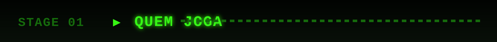
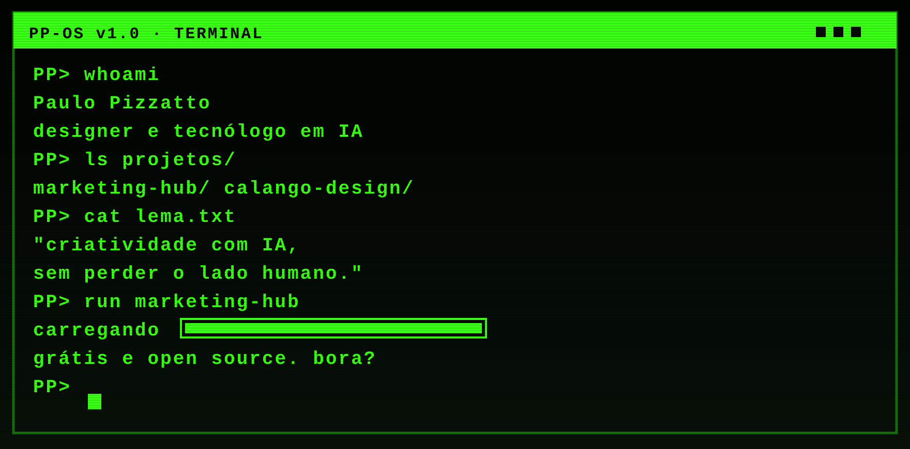
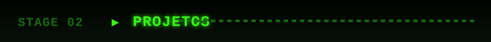
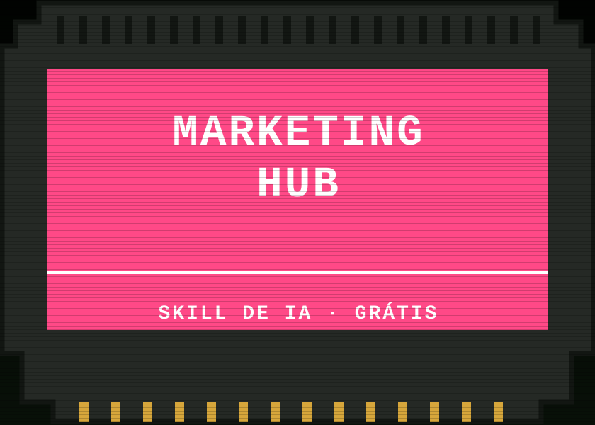
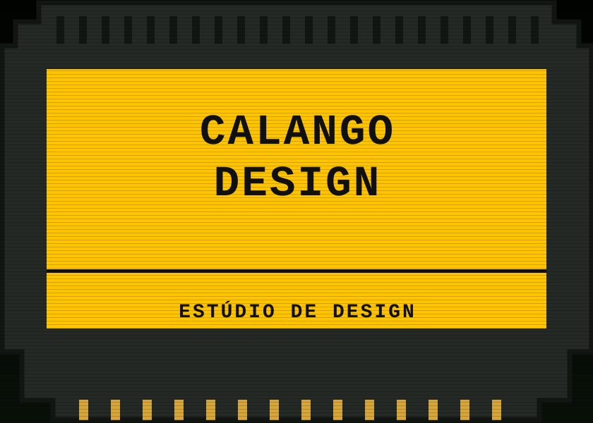
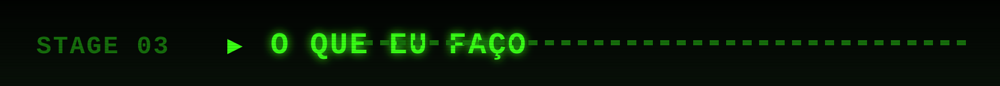
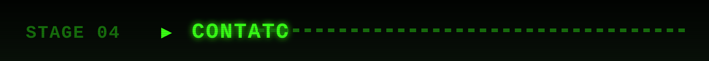

<p align="center"></p>
<p align="center"></p>

<p align="center"></p>

Oi, eu sou o **Paulo Pizzatto**, designer e tecnólogo em IA.  
Crio marcas, posts e ferramentas com IA, sem perder o lado humano.


<p align="center">
  <a href="https://github.com/paulopizzatto-del/marketing-hub"></a>
  
</p>

| Cartucho | O que roda |
| --- | --- |
| **[MarketingHub](https://github.com/paulopizzatto-del/marketing-hub)** | Skill open source e gratuita que ajuda a IA a escrever na voz de cada marca. |
| **Calango Design** | Estúdio de design para pequenos negócios. *Criatividade que acompanha seu corre.* |



```txt
> DESIGN ......... identidade visual e posts para pequenos negócios
> IA ............. ferramentas de marketing com IA, abertas no GitHub
> CONTEÚDO ....... textos e posts no LinkedIn
```


<p align="center">
  
  
  
</p>

<p align="center"></p>