<p align="center">
  <picture><source media="(prefers-color-scheme: dark)" srcset="assets/escuro/tela-inicial.gif">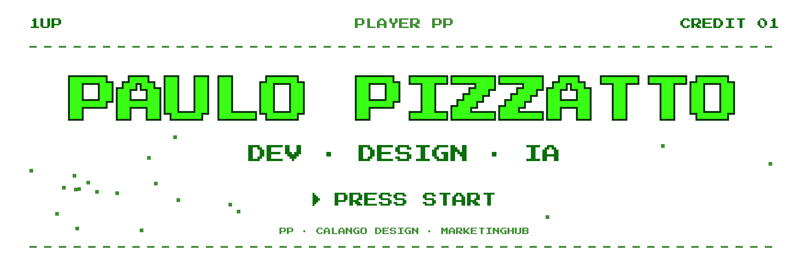</picture>
</p>

<h3 align="center">Oi! Eu sou o Paulo Pizzatto 👾</h3>

<p align="center">
  Tenho 18 anos e sou <b>desenvolvedor e tecnólogo criativo em design e IA</b>.<br>
  Hoje trabalho na <b>SDS Soluções Digitais em Sinistros</b>, juntando design, conteúdo e inteligência artificial no dia a dia.<br>
  Fora de lá, crio ferramentas abertas de marketing com IA e cuido da Calango Design.
</p>

<p align="center">
  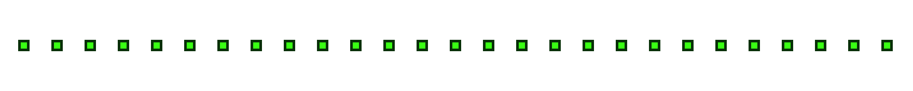
</p>

<picture><source media="(prefers-color-scheme: dark)" srcset="assets/escuro/fase-01.png">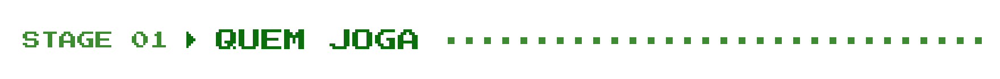</picture>

<p align="center">
  <picture><source media="(prefers-color-scheme: dark)" srcset="assets/escuro/terminal.gif">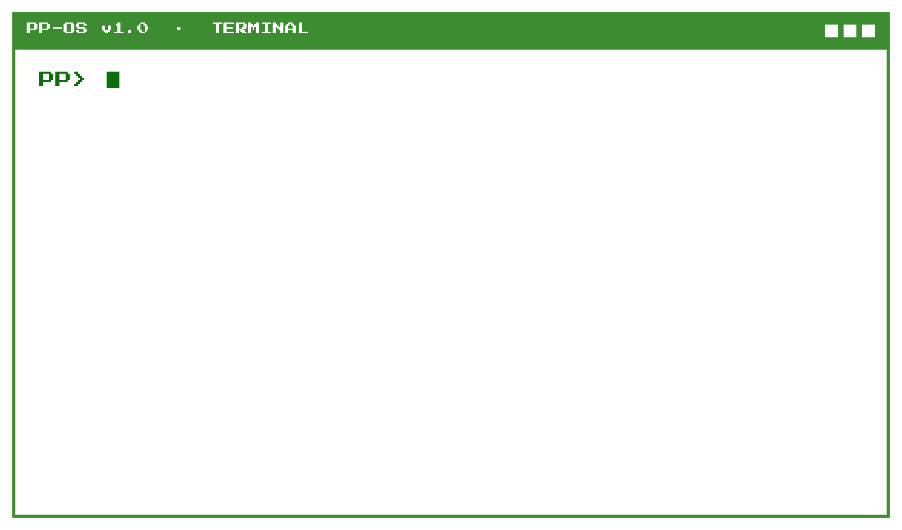</picture>
</p>

**Ficha do jogador**

| Atributo | Valor |
| --- | --- |
| Nome | Paulo Pizzatto |
| Idade | 18 anos |
| Classe | Desenvolvedor · tecnólogo criativo em design e IA |
| Guilda atual | SDS Soluções Digitais em Sinistros |
| Projetos | MarketingHub · Calango Design |
| Lema | Criatividade com IA, sem perder o lado humano. |

<picture><source media="(prefers-color-scheme: dark)" srcset="assets/escuro/fase-02.png">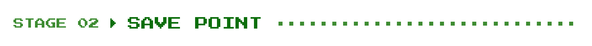</picture>

A SDS é o meu primeiro emprego. Entrei como assistente administrativo e, em cerca de dez meses, passei a atuar como tecnólogo em IA e design. Cada fase até aqui:

```txt
[x] CHECKPOINT 1 ... primeiro emprego: assistente administrativo na SDS
[x] CHECKPOINT 2 ... tecnólogo em IA e design na SDS
[>] FASE ATUAL ..... MarketingHub aberto no GitHub + Calango Design
[ ] PRÓXIMA FASE ... carregando...
```

<picture><source media="(prefers-color-scheme: dark)" srcset="assets/escuro/fase-03.png">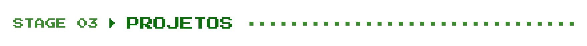</picture>

<p align="center">
  <a href="https://github.com/paulopizzatto-del/marketing-hub">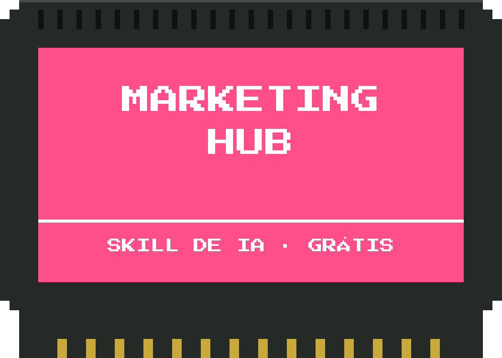</a>
  <a href="https://calangodesign.com.br/">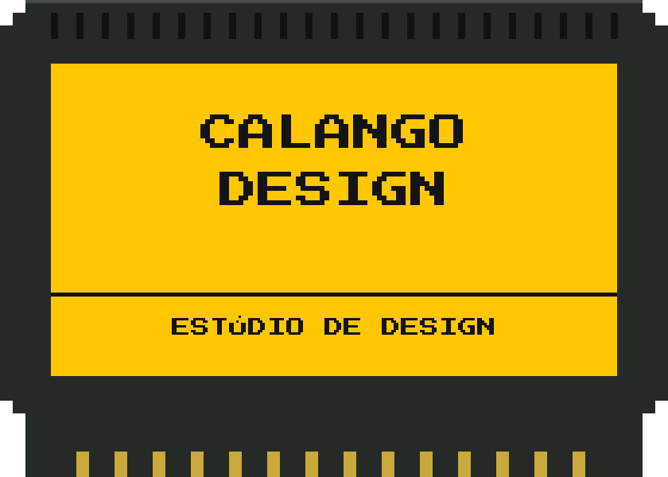</a>
</p>

**[MarketingHub](https://github.com/paulopizzatto-del/marketing-hub)**: uma skill open source e gratuita que ajuda a IA a escrever na voz de cada marca. Você monta um perfil da marca (tom, palavras, exemplos reais) e a IA usa esse perfil para criar posts que soam como a marca, e não como robô. Cada marca fica num perfil separado.

**Calango Design**: estúdio de design para pequenos negócios. Identidade visual, posts e peças para redes sociais. *Criatividade que acompanha seu corre.*

<picture><source media="(prefers-color-scheme: dark)" srcset="assets/escuro/fase-04.png">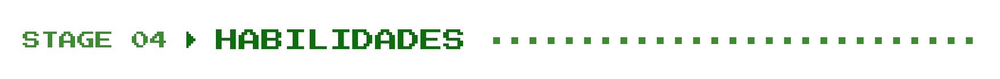</picture>

| Power-up | O que eu faço |
| --- | --- |
| Design | Identidade visual, logos, posts, carrosséis e peças para redes sociais. |
| IA aplicada | Prompts, skills e fluxos de trabalho com ChatGPT e Claude. |
| Desenvolvimento | Ferramentas e automações com IA, como o MarketingHub. |
| Conteúdo | Textos e posts para LinkedIn e Instagram. |

**Inventário:** ChatGPT · Claude · GitHub · Canva · Buffer

<picture><source media="(prefers-color-scheme: dark)" srcset="assets/escuro/fase-05.png">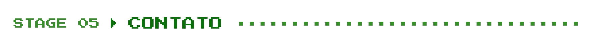</picture>

<p align="center">Bora conversar sobre design, IA ou algum projeto? Me chama por aqui:</p>

<p align="center">
  <a href="https://www.linkedin.com/in/paulo-pizzatto-33b1313a8/"><picture><source media="(prefers-color-scheme: dark)" srcset="assets/escuro/botao-linkedin.png">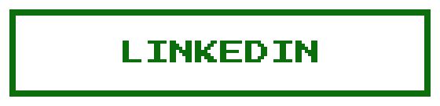</picture></a>
  <a href="https://www.instagram.com/calangodesignbr/?hl=pt-br"><picture><source media="(prefers-color-scheme: dark)" srcset="assets/escuro/botao-instagram.png">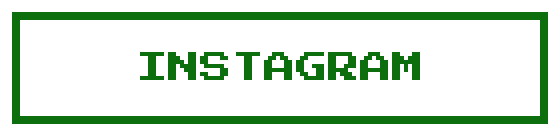</picture></a>
  <a href="mailto:paulo.pizzatto@sdssolucoes.com.br"><picture><source media="(prefers-color-scheme: dark)" srcset="assets/escuro/botao-email.png">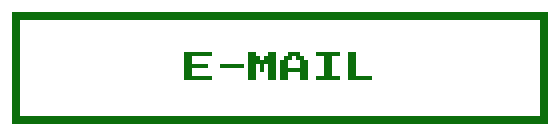</picture></a>
</p>

<p align="center">
  <picture><source media="(prefers-color-scheme: dark)" srcset="assets/escuro/rodape.gif"></picture>
</p>
